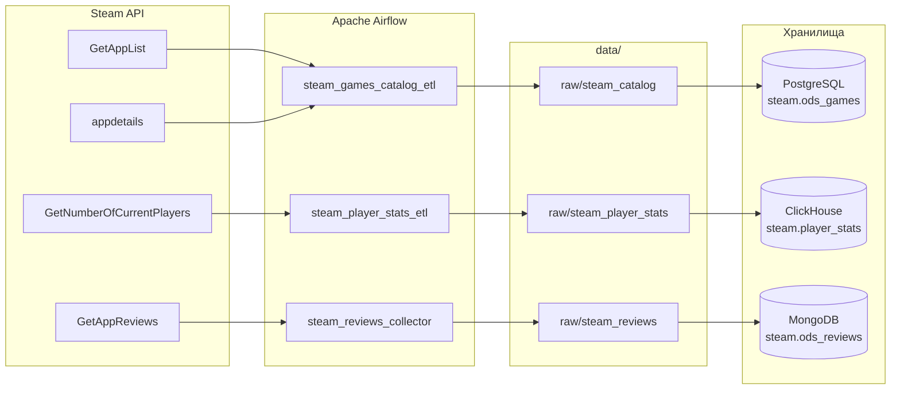

# Лабораторная работа №1

## «Работа с Airflow. ETL-процесс»

**Проект:** сбор, обработка и загрузка сырых данных Steam в ODS-слой  
**Оркестрация:** Apache Airflow 3.3.2  
**Хранилища:** PostgreSQL 16, MongoDB 6.0, ClickHouse 24.8  
**Источник данных:** официальные API Steam

---

## 1. Цель работы

Реализовать ETL-процессы, которые:

1. собирают сырые данные из открытого источника;
2. загружают их в выбранные хранилища (ODS-слой);
3. оркестрируются через Apache Airflow в Docker;
4. позволяют сравнить несколько хранилищ по выбранным критериям и выбрать подходящее для дальнейшей аналитики.

В качестве источника используется Steam — игровая торговая площадка и платформа с открытыми API.

## 2. Источники данных

Используются три независимых набора данных Steam, логически разделённых по смыслу.

| Набор | API | Что собирается |
|---|---|---|
| Каталог игр | `IStoreService/GetAppList/v1`, `store.steampowered.com/api/appdetails` | AppID, название, цена, разработчики, издатели, жанры, дата выхода, описание, полный JSON карточки |
| Онлайн игроков | `ISteamUserStats/GetNumberOfCurrentPlayers/v1` | Текущее число игроков для выбранных игр |
| Отзывы | `IUserReviewsService/GetAppReviews/v1` | Текст отзывов, оценка, голоса, язык, автор, время создания и обновления |

Для каталога нужен `STEAM_API_KEY`. Для онлайна и отзывов ключ не требуется.

## 3. Архитектура решения

### 3.1 Компоненты

- **Airflow** запускает DAG’и и хранит историю запусков в PostgreSQL.
- **PostgreSQL** используется одновременно как metadata-база Airflow и как ODS-хранилище каталога в схеме `steam`.
- **MongoDB** хранит сырые отзывы в коллекции `steam.ods_reviews`.
- **ClickHouse** хранит временные ряды онлайна в таблице `steam.player_stats`.
- **Файловое хранилище** (`data/`) используется как промежуточный слой: сырые ответы API и подготовленные файлы. Каталог `data` смонтирован в контейнеры Airflow.

### 3.2 Поток данных

## 4. Обоснование выбора хранилищ

Используется polyglot persistence: под каждый тип данных выбрано хранилище, которое лучше соответствует его структуре и нагрузке.

### PostgreSQL

**Для чего:** каталог игр.

Почему:

- строгая схема и ограничения целостности;
- первичный ключ `appid`, удобный upsert `ON CONFLICT`;
- транзакционность и предсказуемость;
- поддержка JSONB для хранения полного исходного ответа API;
- удобные JOIN’ы и агрегации для дальнейшего DDS-слоя.

### MongoDB

**Для чего:** отзывы.

Почему:

- отзыв — документ с вложенной структурой автора;
- набор полей может меняться без миграции схемы;
- удобно хранить большие текстовые поля и вложенные объекты;
- `_id = recommendationid` даёт естественную идемпотентность.

### ClickHouse

**Для чего:** статистика онлайна.

Почему:

- данные представляют собой временной ряд «appid + время → число игроков»;
- колоночное хранение и сжатие эффективны для агрегаций;
- высокая скорость вставки и чтения больших диапазонов;
- `ReplacingMergeTree` позволяет схлопывать повторные вставки.

## 5. ETL-процессы

### 5.1 `steam_games_catalog_etl`

**Расписание:** `@daily`  
**Слой:** ODS  
**Хранилище:** PostgreSQL

Этапы:

1. `count_existing_games` — считает текущее число игр в `steam.ods_games`.
2. `check_global_limit` — ShortCircuit: останавливает DAG при достижении `max_games_total`.
3. `extract_master_app_list` — получает полный список AppID из Steam с пагинацией.
4. `get_existing_appids` — читает уже загруженные AppID.
5. `get_failed_appids` — читает AppID, которые уже исчерпали лимит повторов.
6. `select_unprocessed_batch` — anti-join: оставляет только новые AppID, берёт `batch_size` штук.
7. `fetch_game_details` — запрашивает карточки игр с задержкой 1.2 с между запросами.
8. `transform_game_details` — приводит данные к плоской структуре.
9. `load_to_postgres` — upsert в `steam.ods_games` и сохранение неудачных AppID.

Параметры по умолчанию:

- `batch_size = 100`;
- `max_games_total = 10000`;
- повторы DAG: 3;
- execution timeout: 2 часа.

Идемпотентность: `INSERT ... ON CONFLICT (appid) DO UPDATE`, поэтому повторная загрузка той же игры не создаёт дубликат.

### 5.2 `steam_player_stats_etl`

**Расписание:** каждые 3 часа (`0 */3 * * *`)  
**Слой:** ODS  
**Хранилище:** ClickHouse

Этапы:

1. `select_target_games` — выбирает игры из `steam.ods_games`.
2. `fetch_player_stats` — запрашивает текущее число игроков через Steam API.
3. `transform_player_stats` — приводит данные к структуре таблицы ClickHouse.
4. `load_to_clickhouse` — пакетная вставка в `steam.player_stats` через HTTP и `JSONEachRow`.

Параметры по умолчанию:

- `batch_size = 200`;
- `request_delay = 0.5` с;
- повторы DAG: 2;
- execution timeout: 30 минут.

Если каталог пуст, DAG завершается через `AirflowSkipException`, а не падает.

### 5.3 `steam_reviews_collector`

**Расписание:** `@daily`  
**Слой:** ODS  
**Хранилище:** MongoDB

Этапы:

1. `select_top_games` — выбирает топ-N игр из `steam.ods_games` по числу рекомендаций (`raw_json.recommendations.total`).
2. `fetch_reviews` — листает отзывы по cursor, до `max_pages_per_game` страниц на игру.
3. `transform_reviews` — очищает HTML и управляющие символы, переводит Unix timestamp в UTC, формирует JSONL.
4. `load_reviews_mongo` — проверяет наличие `_id = recommendationid` и вставляет только новые документы.

Параметры по умолчанию:

- `top_n = 100`;
- `max_pages_per_game = 3`;
- `request_delay = 1.5` с;
- при HTTP 429 выполняются до 3 повторов с экспоненциальной задержкой.

Идемпотентность: повторная загрузка не создаёт дубликаты, потому что `_id` документа равен `recommendationid`.

### 5.4 `steam_storage_benchmark`

**Запуск:** вручную (`schedule=None`)  
**Назначение:** сравнение PostgreSQL, MongoDB и ClickHouse на одинаковом синтетическом датасете.

 Используется только для сравнительного анализа в рамках лабораторной работы.

Этапы:

1. `prepare_dataset` — генерирует датасет максимального размера с `seed=42`.
2. `bench_postgres` — замеры для PostgreSQL.
3. `bench_mongodb` — замеры для MongoDB.
4. `bench_clickhouse` — замеры для ClickHouse.
5. `aggregate_results` — сводит прогоны в CSV и считает медианы.
6. `cleanup_benchmark_tables` — удаляет тестовые таблицы при любом исходе (`ALL_DONE`).

Движки запускаются последовательно, чтобы вставки не влияли на замеры друг друга.

## 6. Модель данных ODS

### 6.1 PostgreSQL: `steam.ods_games`

| Поле | Тип | Назначение |
|---|---|---|
| `appid` | `BIGINT PRIMARY KEY` | идентификатор игры Steam |
| `name` | `TEXT` | название |
| `is_free` | `BOOLEAN` | бесплатная игра |
| `developers` | `TEXT` | разработчики |
| `publishers` | `TEXT` | издатели |
| `genres` | `TEXT` | жанры |
| `release_date` | `TEXT` | дата выхода в исходном виде |
| `short_description` | `TEXT` | краткое описание |
| `raw_json` | `JSONB` | полный исходный ответ API |
| `loaded_at` | `TIMESTAMPTZ` | время первой загрузки |
| `updated_at` | `TIMESTAMPTZ` | время последнего обновления |

Дополнительно созданы:

- `steam.failed_appids` — AppID, которые не удалось загрузить, и счётчик повторов;
- `steam.etl_state` — таблица для глобального состояния пайплайна;
- `steam.v_catalog_stats` — представление со сводной статистикой каталога;
- индексы по `name`, `is_free`, `loaded_at` и GIN-индекс по `raw_json`;
- триггер, обновляющий `updated_at` при изменении строки.

### 6.2 ClickHouse: `steam.player_stats`

| Поле | Тип |
|---|---|
| `appid` | `UInt32` |
| `game_name` | `String` |
| `current_players` | `UInt64` |
| `collected_at` | `DateTime('UTC')` |

Движок: `ReplacingMergeTree`  
Партиционирование: по месяцу `collected_at`  
Ключ сортировки: `(appid, collected_at)`

### 6.3 MongoDB: `steam.ods_reviews`

Основные поля документа:

- `_id` — `recommendationid` в виде строки;
- `appid`, `game_name`;
- `language`, `review_text`;
- `voted_up`, `votes_up`, `votes_funny`, `weighted_vote_score`;
- `comment_count`, `steam_purchase`, `received_for_free`;
- `written_during_early_access`, `refunded`;
- `timestamp_created`, `timestamp_updated`;
- `author` — вложенный документ с `steamid`, `num_reviews`, `playtime_forever`, `playtime_at_review`, `last_played`;
- `collected_at`.

Созданы индексы по `appid` и `timestamp_created`.

## 7. Сравнительный анализ хранилищ

### 7.1 Критерии

Выбраны критерии, важные для ODS-слоя и дальнейшей аналитики:

1. скорость пакетной вставки;
2. скорость агрегирующего запроса;
3. занимаемый размер;
4. гарантии целостности и транзакционность;
5. гибкость схемы;
6. удобство аналитических агрегаций.

### 7.2 Методика benchmark

- Датасет synthetic reviews: та же структура, что у отзывов Steam.
- `seed=42`, поэтому все прогоны воспроизводимы.
- Размеры: 10 000, 50 000 и 100 000 документов.
- По 3 прогона на каждую пару «хранилище + размер», в таблице — медиана.
- Размер батча: 5 000 строк.
- Замеряется только вставка; подготовка данных вынесена за пределы таймера.
- После вставки проверяется фактическое число строк.
- Перед чтением размера MongoDB выполняется `fsync`, затем суммируются `storageSize` и `totalIndexSize`.
- Дополнительно замеряется агрегация: количество и средняя оценка отзывов по `appid` для положительных отзывов.
- Тестовые объекты изолированы:
  - PostgreSQL: `bench.reviews`;
  - MongoDB: `steam_bench.reviews`;
  - ClickHouse: `steam.bench_reviews`.

### 7.3 Результаты: скорость

| Размер | PostgreSQL, вставка | MongoDB, вставка | ClickHouse, вставка | PostgreSQL, запрос | MongoDB, запрос | ClickHouse, запрос |
|---:|---:|---:|---:|---:|---:|---:|
| 10 000 | 0.95 с | 0.17 с | 0.31 с | 6.0 мс | 22.6 мс | 18.3 мс |
| 50 000 | 4.06 с | 0.76 с | 1.28 с | 25.0 мс | 146.9 мс | 16.6 мс |
| 100 000 | 8.58 с | 1.65 с | 2.48 с | 38.8 мс | 228.9 мс | 20.9 мс |

### 7.4 Результаты: размер

| Размер | PostgreSQL, физический размер | ClickHouse, физический размер | MongoDB, физический размер |
|---:|---:|---:|---:|
| 10 000 | 3.27 МБ | 0.88 МБ | 1.33 МБ |
| 50 000 | 16.11 МБ | 4.41 МБ | 7.35 МБ |
| 100 000 | 32.17 МБ | 8.80 МБ | 15.09 МБ |

### 7.5 Интерпретация

**Скорость вставки.**

- MongoDB быстрее всех: около 1.65 с на 100 000 документов.
- ClickHouse второй: около 2.48 с.
- PostgreSQL медленнее в 3–6 раз: около 8.58 с, что объясняется WAL, поддержкой первичного ключа и транзакционными гарантиями.

**Скорость запроса.**

- На 10 000 строк PostgreSQL быстрее всех: 6.0 мс; ClickHouse — 18.3 мс, MongoDB — 22.6 мс.
- На 50 000 и 100 000 строк ClickHouse выходит вперёд: 16.6 и 20.9 мс против 25.0 и 38.8 мс у PostgreSQL.
- MongoDB заметно медленнее на 100 000 документов: 228.9 мс, потому что агрегация выполняется без индекса по `voted_up` и с накладными расходами документной модели.

**Размер.**

- ClickHouse самый компактный: 8.80 МБ на 100 000 строк.
- MongoDB занимает 15.09 МБ с учётом индекса `_id`.
- PostgreSQL занимает 32.17 МБ, включая индексы и TOAST; это самый большой физический размер в сравнении.

**Целостность и гибкость.**

- PostgreSQL даёт транзакции, первичные ключи, ограничения и удобные JOIN’ы.
- MongoDB даёт гибкую документную схему и естественную идемпотентность по `_id`.
- ClickHouse даёт высокую скорость агрегаций и сжатие, но не предназначен для транзакционных обновлений и строгих ограничений.

## 8. Выбор хранилища

По результатам сравнения:

- **PostgreSQL** — лучшее хранилище для каталога игр: важнее целостность, upsert и возможность строить нормализованный DDS-слой.
- **MongoDB** — лучшее хранилище для сырых отзывов: документная структура, вложенный автор, текстовые поля и гибкая схема.
- **ClickHouse** — лучшее хранилище для онлайна и временных рядов: высокая скорость вставки, компактное хранение и быстрые агрегации.

## 9. Заключение

В рамках ЛР1 реализована система сбора сырых данных Steam и загрузки их в три хранилища:

- PostgreSQL — каталог игр;
- MongoDB — отзывы;
- ClickHouse — статистика онлайна.

ETL-процессы оркестрируются Apache Airflow в Docker, поддерживают повторные запуски, ограничение объёма, обработку ошибок и rate limiting.

По результатам сравнения для аналитического слоя выбран ClickHouse, для каталога — PostgreSQL, для сырых отзывов — MongoDB.
