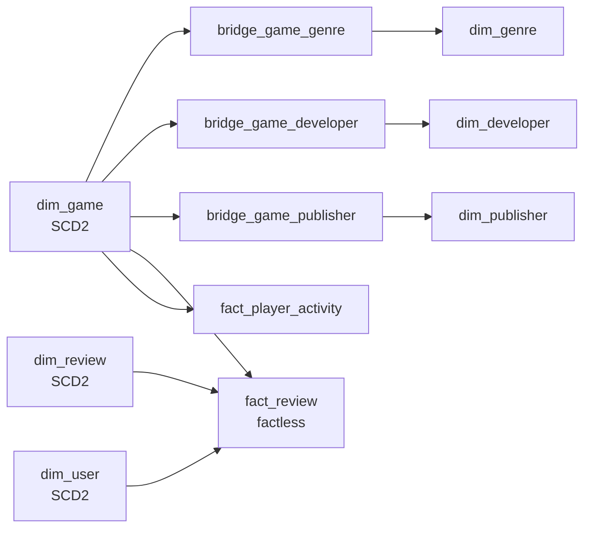
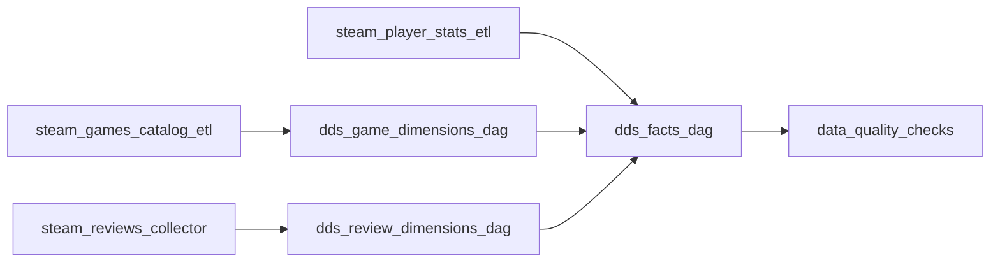

# Лабораторная работа №2

## «Нормализация данных. Data Quality»

**Проект:** построение DDS-слоя Steam на основе ODS-данных из ЛР1  
**Оркестрация:** Apache Airflow 3.3.2  
**Хранилище:** PostgreSQL  
**Слой:** DDS с SCD2 и Data Quality

---

## 1. Цель работы

Разработать базовое аналитическое хранилище на основе сырых данных ЛР1:

1. привести данные к схеме «снежинка» и нормализовать справочники;
2. реализовать ETL-процессы очистки, приведения типов, обогащения и агрегации;
3. реализовать SCD2 для изменяющихся измерений;
4. построить зависимости между ODS- и DDS-процессами;
5. реализовать DAG проверок качества данных.

## 2. Исходные данные ODS

Источник DDS — ODS-слой PostgreSQL:

| Таблица | Назначение |
|---|---|
| `steam.ods_games` | каталог игр, жанры, разработчики, издатели |
| `steam.ods_reviews` | отзывы, авторы, голоса, флаги |
| `steam.ods_player_stats` | снимки онлайна игроков |

ODS-слой загружается DAG’ами ЛР1:

- `steam_games_catalog_etl`;
- `steam_reviews_collector`;
- `steam_player_stats_etl`.

## 3. Структура DDS

### 3.1. Схема «снежинка»



Для игр, разработчиков, издателей и жанров используется нормализованная снежинка:
справочники вынесены в отдельные таблицы, связи «многие ко многим» — в bridge-таблицы.

### 3.2. Измерения

| Таблица | Тип | Ключ | Особенности |
|---|---|---|---|
| `dds.dim_game` | SCD2 | `game_sk` / `appid` | история игр, `valid_from`, `valid_to`, `is_current` |
| `dds.dim_user` | SCD2 | `user_sk` / `steamid` | история метрик пользователя |
| `dds.dim_review` | SCD2 | `review_sk` / `review_id` | история текста, флагов и голосов отзыва |
| `dds.dim_genre` | SCD1 | `genre_id` | справочник жанров |
| `dds.dim_developer` | SCD1 | `developer_id` | справочник разработчиков |
| `dds.dim_publisher` | SCD1 | `publisher_id` | справочник издателей |

### 3.3. Факты

| Таблица | Grain | Ключи | Метрики |
|---|---|---|---|
| `dds.fact_review` | одна строка на версию отзыва | `review_sk`, `game_sk`, `user_sk` | factless fact: связывает отзыв с игрой и пользователем |
| `dds.fact_player_activity` | игра + дата + час | `game_sk`, `activity_date`, `hour_of_day` | `current_players`, `avg_players`, `max_players`, `samples` |

### 3.4. Обоснование 3НФ и factless fact

- Жанры, разработчики и издатели не дублируются в `dim_game`, а хранятся в отдельных справочниках.
- Связи «игра — жанр/разработчик/издатель» вынесены в bridge-таблицы.
- `dim_review` содержит описательные атрибуты и меры отзыва, а `fact_review` фиксирует связь отзыва с игрой и пользователем.
- Такой factless fact выбран осознанно: отзыв одновременно является событием и сущностью с версионируемыми атрибутами. Меры отзыва хранятся в его SCD2-версии, чтобы текст, флаги и голоса одной версии были согласованы.
- Для активности используется классический факт с мерами и grain `(game_sk, activity_date, hour_of_day)`.

## 4. SCD2

### 4.1. Схема

Для каждой SCD2-таблицы используются:

```text
<entity>_sk     — суррогатный ключ версии
<natural_key>   — бизнес-ключ
row_hash        — хеш отслеживаемых атрибутов
valid_from      — начало действия версии
valid_to        — конец действия версии
is_current      — признак текущей версии
```

Для текущих версий создан частичный уникальный индекс:

```sql
CREATE UNIQUE INDEX uq_dim_game_current
    ON dds.dim_game (appid)
    WHERE is_current;
```

Аналогичные индексы есть для `dim_user` и `dim_review`.

### 4.2. Начальная загрузка

Первая версия получает:

```text
valid_from = '-infinity'
valid_to   = 'infinity'
is_current = true
```

Это позволяет связать с первой версией исторические отзывы и точки активности, которые появились раньше первого запуска DDS.

### 4.3. Изменение данных

При изменении отслеживаемых атрибутов:

1. текущая версия закрывается:
   `valid_to = now()`, `is_current = false`;
2. создаётся новая версия:
   `valid_from = now()`, `valid_to = 'infinity'`, `is_current = true`;
3. для игры bridge-таблицы заполняются под новый `game_sk`.

Сравнение версий выполняется по `row_hash`, который включает:

- для игры: название, `is_free`, дату выхода, описание, жанры, разработчиков, издателей;
- для пользователя: `num_reviews`, `playtime_forever`;
- для отзыва: текст, язык, флаги, голоса, score, даты, `collected_at`.

Повторный запуск без изменений не создаёт новых версий.

### 4.4. Связь фактов с версиями

- `fact_player_activity` связывается с версией игры, действовавшей на `collected_at`;
- `fact_review` связывается с версией игры и пользователя на `timestamp_created`;
- `fact_review.review_sk` указывает на конкретную версию отзыва.

Это позволяет корректно обрабатывать исторические и поздно пришедшие события.

## 5. DAG’и DDS

### 5.1. `dds_game_dimensions_dag`

Загружает:

- `dim_game`;
- `dim_genre` и `bridge_game_genre`;
- `dim_developer` и `bridge_game_developer`;
- `dim_publisher` и `bridge_game_publisher`.

Задачи:

```text
wait_for_ods_catalog
  -> check_ods_games
  -> sync_game_dimensions
  -> validate_game_dimensions
```

`sync_game_dimensions` в одной транзакции обновляет версии игр и bridge-таблицы.

### 5.2. `dds_review_dimensions_dag`

Загружает:

- `dim_user` с SCD2;
- `dim_review` с SCD2.

Задачи:

```text
wait_for_ods_reviews
  -> check_ods_reviews
  -> sync_dim_user
  -> sync_dim_review
  -> validate_review_dimensions
```

### 5.3. `dds_facts_dag`

Загружает:

- `fact_review` из `steam.ods_reviews`;
- `fact_player_activity` из `steam.ods_player_stats`.

Задачи:

```text
wait_for_game_dimensions
wait_for_review_dimensions
wait_for_ods_player_stats
  -> check_prerequisites
  -> [extract_reviews -> transform_reviews -> load_fact_review]
  -> [aggregate_player_activity -> load_fact_player_activity]
  -> log_fact_run
```

Источник онлайна — PostgreSQL `steam.ods_player_stats`, а не ClickHouse.

Сенсор `wait_for_ods_player_stats` использует `execution_date_fn`, который возвращает
все 8 logical dates окна активности (`00:00, 03:00, ..., 21:00`). Поэтому дневной
факт не считается, пока не завершился последний трёхчасовой батч дня.

### 5.4. `data_quality_checks`

Запускается после `dds_facts_dag` и выполняет шесть проверок:

- `dq_volume_reviews`;
- `dq_volume_activity`;
- `dq_anomaly_reviews`;
- `dq_anomaly_activity`;
- `dq_orphans`;
- `dq_scd_integrity`.

## 6. Зависимости ETL



Используются `ExternalTaskSensor` с выравниванием на daily/3-hour сетку.
DDS-процессы не запускаются, пока не завершились соответствующие ODS-расчёты.

## 7. Data Quality

### 7.1. Проверки

| Проверка | Что проверяет |
|---|---|
| `volume_reviews` | доля ODS-отзывов, дошедших до текущих фактов |
| `volume_activity` | покрытие ODS-точек онлайна суммой `samples` факта |
| `anomaly_reviews` | отрицательные голоса, score вне `[-1, 1]`, будущие даты |
| `anomaly_activity` | отрицательный онлайн, `max < avg`, онлайн выше порога |
| `orphans` | факты без измерений и покрытие `appid` |
| `scd_integrity` | одна текущая версия, корректные интервалы, отсутствие пересечений |

### 7.2. Результаты

По результатам прогона:

```text
volume_reviews    passed  ratio=1.0
volume_activity   passed  ratio=1.0
anomaly_reviews   passed  0
anomaly_activity  passed  0
orphans           passed  0
scd_integrity     passed  0
```

Все 6 проверок — `passed`, `warning` и `error` отсутствуют.

## 8. Результаты DDS

Текущее состояние после загрузки:

| Объект | Количество |
|---|---:|
| `dds.dim_game` | 298 |
| `dds.dim_user` | 24 104 |
| `dds.dim_review` | 27 307 |
| `dds.fact_review` | 27 307 |
| `dds.fact_player_activity` | 100 |

Проверка SCD2:

```text
дубликаты текущих версий dim_game   = 0
дубликаты текущих версий dim_user   = 0
дубликаты текущих версий dim_review = 0
```

## 9. Воспроизводимость

Поднять стек:

```bash
docker compose up -d
```

Пересоздать DDS-схему:

```bash
docker compose exec -T postgres psql -U airflow -d airflow \
  -c "DROP SCHEMA IF EXISTS dds CASCADE;"

docker compose exec -T postgres psql -U airflow -d airflow \
  -f /docker-entrypoint-initdb.d/init_dds.sql
```

Запустить DAG’и в Airflow в порядке:

1. `dds_game_dimensions_dag`;
2. `dds_review_dimensions_dag`;
3. `dds_facts_dag`;
4. `data_quality_checks`.

При запуске через CLI:

```bash
docker compose exec -T airflow-apiserver \
  airflow dags test dds_game_dimensions_dag 2026-11-15T00:00:00+00:00

docker compose exec -T airflow-apiserver \
  airflow dags test dds_review_dimensions_dag 2026-11-15T00:00:00+00:00

docker compose exec -T airflow-apiserver \
  airflow dags test dds_facts_dag 2026-11-15T00:00:00+00:00

docker compose exec -T airflow-apiserver \
  airflow dags test data_quality_checks 2026-11-15T00:00:00+00:00
```

Проверить данные:

```bash
docker compose exec -T postgres psql -U airflow -d airflow \
  -c "SELECT count(*) FROM dds.dim_game WHERE is_current;"

docker compose exec -T postgres psql -U airflow -d airflow \
  -c "SELECT count(*) FROM dds.fact_review;"

docker compose exec -T postgres psql -U airflow -d airflow \
  -c "SELECT * FROM dds.dq_results ORDER BY checked_at DESC;"
```

## 10. Ограничения

- `fact_review` реализован как factless fact; меры отзыва находятся в SCD2-измерении `dim_review`. Это осознанная нормализация, а не классический fact с мерами.
- Отдельное измерение дат не создаётся: дата хранится в `fact_player_activity.activity_date` и в `dim_review.timestamp_created` как вырожденное измерение.
- ODS хранит жанры, разработчиков и издателей строкой через запятую; разбор не поддерживает запятые внутри названий компаний без дополнительного формата.
- SCD2-история увеличивает объём `dim_review` и bridge-таблиц; для больших объёмов потребуется партиционирование или архивирование старых версий.
- DDS-факты зависят от корректного окна `data_interval_end`; при ручных прогонах на исторических датах окно активности нужно согласовывать с `collected_at` в ODS.

## 11. Заключение

В рамках ЛР2 реализованы:

- DDS-схема «снежинка» с нормализованными справочниками и bridge-таблицами;
- SCD2 для игр, пользователей и отзывов;
- ETL-DAG’и загрузки измерений и фактов;
- зависимости ODS → DDS-измерения → DDS-факты → Data Quality;
- DAG проверок качества данных;
- интеграция с PostgreSQL-ODS и отказ от ClickHouse для активности.

Полный прогон цепочки завершён успешно: факты загружены, все шесть DQ-проверок прошли без ошибок, SCD-инварианты соблюдены.
