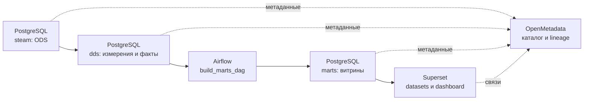

# Лабораторная работа №3

## «Витрины данных. Визуализация и Data Lineage»

- **Проект:** аналитика данных Steam на основе DDS-слоя.
- **Оркестрация:** Apache Airflow 3.3.2.
- **Хранилище:** PostgreSQL 16.
- **Визуализация:** Apache Superset 4.1.2.
- **Каталог метаданных:** OpenMetadata 1.8.0.

---

## 1. Цель работы

Построить аналитический слой на основе данных ЛР2:

1. создать витрины для анализа отзывов и активности игроков;
2. организовать обновление витрин и проверку их качества в Apache Airflow;
3. подготовить набор визуализаций и дашборд в Apache Superset;
4. описать происхождение данных от ODS до витрин и дашборда в OpenMetadata;
5. подготовить проверочные запросы и инструкции для воспроизведения.

## 2. Исходные данные DDS

Источником витрин служит DDS-слой PostgreSQL, построенный в ЛР2.

| Таблица | Назначение |
|---|---|
| `dds.dim_game` | версии игр и их атрибуты, включая `appid` и название |
| `dds.dim_review` | версии отзывов, оценка и время создания |
| `dds.fact_review` | связь версии отзыва с игрой и пользователем |
| `dds.fact_player_activity` | почасовые показатели онлайна игр |
| `dds.dim_genre`, `dds.bridge_game_genre` | жанры и их связь с версиями игр |
| `dds.dim_publisher`, `dds.bridge_game_publisher` | издатели и их связь с версиями игр |

Измерения игр и отзывов используют SCD2. Факты ссылаются на конкретные версии через `game_sk` и `review_sk`; для объединения версий одной игры используется `appid`.

## 3. Архитектура решения

### 3.1. Компоненты

- **Интеграция веток:** единый Compose и схема инициализации взяты за основу из `lab3_feature_a`; расширенные витрины, BI-настройки и отчёт развиты на основе `lab3_feature_b`. Несовместимые версии DAG и DDL не объединяются автоматически.
- **PostgreSQL** хранит исходные данные ODS в схеме `steam`, DDS в схеме `dds` и витрины в схеме `marts`.
- **Apache Airflow** ожидает завершения загрузки DDS и управляет пересчётом витрин и проверками качества.
- **Apache Superset** предназначен для подключения к BI-представлениям и построения дашборда.
- **OpenMetadata** предназначен для каталога метаданных и отображения связей между источниками, витринами и дашбордом. Для поиска используется OpenSearch.
- **Отдельные базы PostgreSQL** используются для метаданных Superset и OpenMetadata.

### 3.2. Поток данных



Рисунок показывает целевую цепочку происхождения данных. Фактическое отображение связей в OpenMetadata проверяется после загрузки метаданных.

## 4. Витрины данных

Витрины создаются в схеме `marts`. Первичные и внешние ключи связывают их с измерениями DDS; дополнительно созданы индексы по `appid` и дате для витрин игр и активности.

### 4.1. `marts.mart_game_daily_metrics`

**Зерно:** `(activity_date, game_sk)`.

| Поля | Назначение |
|---|---|
| `activity_date`, `game_sk`, `appid`, `game_name`, `is_free` | дата и версия игры |
| `review_count`, `positive_reviews`, `negative_reviews` | количество отзывов по оценке |
| `positive_ratio`, `avg_weighted_score` | доля положительных отзывов и среднее значение `weighted_score` |
| `avg_players`, `max_players`, `current_players`, `samples` | показатели онлайна и число снимков |
| `hours_covered`, `loaded_at` | число часов с активностью и время загрузки |

Отзывы и активность агрегируются независимо до `(activity_date, game_sk)` и соединяются через `FULL OUTER JOIN`. Это предотвращает перемножение строк при соединении двух фактов и сохраняет даты, для которых есть только отзывы или только активность.

### 4.2. `marts.mart_activity_hourly`

**Зерно:** `(activity_date, hour_of_day, game_sk)`.

Витрина содержит `appid`, название игры, последний наблюдённый, средний и максимальный онлайн, а также число снимков `samples`. Дата и час в исходном факте вычисляются в UTC; для анализа распределения сохраняются день недели и признак выходного дня. Жанр не хранится в часовом зерне, поскольку игра может иметь несколько жанров; при анализе по жанрам используется мост DDS с учётом неаддитивности.

### 4.3. `marts.mart_genre_daily_metrics`

**Зерно:** `(activity_date, genre_id)`.

Содержит название жанра, число игр `games_count`, количество и долю положительных отзывов, средний и максимальный онлайн и число снимков. Число игр считается по различным `appid`, чтобы разные версии одной игры не увеличивали показатель; отзывы считаются по различным идентификаторам с учётом связи игры с жанром.

### 4.4. `marts.mart_publisher_daily_metrics`

**Зерно:** `(activity_date, publisher_id)`.

Дополнительная витрина строится аналогично жанровой, но через `dds.bridge_game_publisher`. Она позволяет сопоставлять количество отзывов и средний онлайн игр издателя.

Игра может относиться к нескольким жанрам или издателям, поэтому её показатели участвуют в каждой соответствующей категории. Сумма метрик по категориям не обязательно совпадает с общим итогом по играм.

## 5. Расчёт показателей

### 5.1. Отзывы

- Для подсчёта выбирается текущая версия отзыва из `dds.dim_review`; версия связывается с фактом по `review_sk`.
- Датой события считается дата `timestamp_created` в UTC.
- `positive_ratio` рассчитывается как `positive_reviews / review_count`; если отзывов нет, значение равно `NULL`.
- В DDS отсутствующий признак `voted_up` приводится к `false` и учитывается как отрицательная оценка.

История агрегируется по дате создания отзыва, но с его текущей оценкой. Поэтому изменение оценки может изменить показатель за прошлый день; предыдущая тональность на момент события таким способом не восстанавливается.

### 5.2. Онлайн

Средний онлайн за несколько часов или игр рассчитывается с учётом числа исходных снимков:

```text
avg_players = sum(avg_players_часа * samples_часа) / sum(samples_часа)
```

Для рейтинга игр SCD2-версии объединяются по `appid`. Средний онлайн жанра или издателя представляет среднее по снимкам отдельных игр, а не суммарный онлайн категории. Максимум категории — максимальное значение отдельной игры. Часовые значения DDS округлены, поэтому итоговое среднее может содержать небольшую погрешность.

## 6. DAG обновления витрин

### 6.1. `build_marts_dag`

- **Расписание:** `@daily`.
- **Слой:** витрины `marts`.
- **Ограничение параллелизма:** `max_active_runs = 1`.

Задачи:

```text
wait_for_dds_facts
  -> check_prerequisites
  -> rebuild_marts
  -> log_mart_run
```

1. `wait_for_dds_facts` ожидает успешного `dds_facts_dag` с тем же `logical_date`.
2. `check_prerequisites` проверяет наличие исходных таблиц и текущих версий игр.
3. `rebuild_marts` полностью пересчитывает четыре витрины и выполняет проверки качества.
4. `log_mart_run` сохраняет сводку о запуске.

Очистка и заполнение витрин выполняются в одной транзакции с уровнем изоляции `REPEATABLE READ`. Проверки запускаются до фиксации транзакции; при ошибке изменения откатываются. Блокировки предотвращают одновременную публикацию, но на время пересчёта могут задерживать чтение витрин.

## 7. Data Quality

### 7.1. Проверки

| Проверка | Что проверяет |
|---|---|
| `uniqueness` | отсутствие дублей по зерну четырёх витрин |
| `ratio`, `review_arithmetic` | диапазон доли положительных отзывов и согласованность числителей и общего количества |
| `review_count_source` | равенство числа отзывов в витрине игр и доступных текущих фактов DDS |
| `current_reviews_without_fact` | предупреждение о текущих версиях отзывов без факта, в том числе из-за фильтрации или ограничения DDS |
| `reviews_without_timestamp` | предупреждение об отзывах без даты создания, исключённых из расчёта |
| `avg_le_max` | неотрицательность онлайна и условие `avg_players <= max_players` |
| `activity_completeness` | соответствие числа точек и суммы `samples` исходному факту активности |
| `orphans` | отсутствие ключей игры, жанра и издателя без измерений |
| `freshness_*` | сверка последних дат источника и витрины; возраст источников активности и отзывов отдельно выдаёт предупреждение при превышении порога |

При несовпадении дат источника и витрины проверка фиксирует ошибку; если оба набора пусты, выдаётся предупреждение. Порог давности источников задаётся параметром DAG `source_max_age_days` и по умолчанию равен двум дням. Результаты сохраняются в `marts.mart_dq_results`; сводка запуска также записывается в `data/processed/marts/<ds>/results.json`. Успешные проверки фиксируются вместе с витринами, а результаты неудачного пересчёта записываются отдельно после отката с признаком `published=false` и записью `build_failed`.

### 7.2. Результаты проверок

Результаты DQ получены после запуска `build_marts_dag`:

| Показатель | Результат |
|---|---|
| Дата и идентификатор запуска | `2026-11-28 07:41:12 UTC`, `manual__2026-11-28T07:40:58.841298+00:00` |
| Количество проверок со статусом `passed` | 14 |
| Количество проверок со статусом `warning` | 1 |
| Количество проверок со статусом `error` | 0 |

Единственное предупреждение — `current_reviews_without_fact`: 1 745 текущих отзывов не попали в DDS-факт из-за ограничения `reviews_limit` и фильтрации. Публикация витрин не блокируется.

## 8. Визуализация в Superset

### 8.1. Подключение и datasets

Для Superset созданы роль `superset_reader` и восемь BI-представлений схемы `marts`. Роль может читать витрины и выбранные таблицы DDS, но не получает доступа к текстам отзывов и идентификаторам пользователей. Скрипт настройки создал подключение `steam-marts`, 8 datasets, 8 charts и dashboard `steam_analytics_lr3` через API Superset.

### 8.2. Визуализации

| Визуализация | Тип | Аналитическая задача |
|---|---|---|
| Топ-15 игр по среднему онлайну | столбчатая диаграмма | сравнить игры по популярности; версии объединяются по `appid` |
| Активность по дню недели и часу UTC | тепловая карта | определить периоды повышенной активности |
| Будни и выходные по часам UTC | столбчатая диаграмма | сопоставить наблюдаемые часы в будни и выходные |
| Динамика отзывов | столбчатая диаграмма | число текущих отзывов по дате создания; окно — последние 90 дней, дни с менее чем 10 отзывами исключены |
| Доля топ-10 жанров по отзывам | круговая диаграмма | сравнить доли жанров в сумме отзывов по выбранным жанрам |
| Положительные и отрицательные отзывы по жанрам | составная столбчатая диаграмма | сравнить состав оценок по жанрам |
| Издатели: отзывы и средний онлайн | пузырьковая диаграмма | сопоставить объём отзывов и онлайн; размер пузыря отражает `samples` |
| Последние проверки качества | таблица | показать статусы, значения и пороги DQ |

В конфигурации используются пять различных `viz_type`: столбчатые диаграммы, тепловая карта, круговая и пузырьковая диаграммы, таблица. Круговая диаграмма показывает доли суммы по жанрам, а не доли уникальных отзывов: одна игра может иметь несколько жанров.

В представлениях показатели предварительно рассчитаны на зерне графика: например, одна строка на игру, день или ячейку день/час. `MAX` на этом зерне возвращает уже рассчитанное значение, а не повторно вычисляет среднее; при изменении группировки это свойство необходимо проверить. Средний онлайн вычисляется с весами `samples`, пропущенные часы не являются нулями.

### 8.3. Аналитические наблюдения

По данным витрин:

| Показатель | Значение |
|---|---|
| Период данных по играм и отзывам | 2010-11-03 — 2026-11-27 |
| Период активности | 2026-11-14 — 2026-11-27 |
| Игра с наибольшим средним онлайном | Counter-Strike 2 (appid 730): 1 024 828,21 |
| Жанр с наибольшим числом отзывов | Action: 31 280 отзывов, доля положительных 0,7554 |
| Наблюдаемые пики активности | Пятница 12:00 UTC — 18 546,06; суббота 12:00 UTC — 18 357,75 |

Второй по среднему онлайну — Dota 2 (691 744,92), третий — Team Fortress 2 (102 334,50). Пик активности приходится на дневные часы UTC в конце рабочей недели и выходные; ночные и утренние часы представлены неравномерно из-за трёхчасового сбора.

## 9. Data Lineage

Для OpenMetadata подготовлены рецепт загрузки метаданных PostgreSQL и декларация связей. Предусмотрена цепочка:

```text
steam.ods_games / ods_reviews / ods_player_stats
  -> dds: измерения, мосты и факты
  -> marts: витрины
  -> BI-представления и дашборд Superset
```

Связи таблиц, pipeline-сущностей и дашборда созданы через API OpenMetadata. Автоматический коннектор Airflow оставлен отключённым из-за несовместимости с Airflow 3; DAG представлены отдельными pipeline-сущностями. В OpenMetadata загружено 32 таблицы, 8 pipeline-сущностей и 1 dashboard; при bootstrap добавлено 68 lineage-связей, ошибок не было. Lineage проверен в UI: для `marts.mart_game_daily_metrics` отображаются upstream-связи с DDS и downstream-связи с витринами.

## 10. Воспроизводимость

Перед запуском необходимо выделить Docker не менее 8 ГБ памяти, настроить `.env` по `.env_example` и `.env_lab3_example`, а также заполнить переменные для BI и метаданных. Пароли и токены не должны попадать в отчёт и скриншоты.

Поднять стек:

```bash
docker compose up -d --build
```

Проверить наличие схемы DDS. Init-скрипты PostgreSQL выполняются только на новом томе; на старом томе при отсутствии DDS необходимо отдельно применить `sql/postgres/init_dds.sql` после проверки совместимости и резервного копирования. Затем выполнить `bash scripts/lab3_bootstrap.sh --no-up`. Скрипт создаёт таблицы витрин, но не заменяет миграцию существующих таблиц с другой структурой. После применения DDL одной из прежних веток сначала сохраните необходимые данные и только с осознанным подтверждением удалите старую схему: `DROP SCHEMA marts CASCADE`. Это удалит витрины, BI-представления и журнал DQ, но не ODS и DDS. Затем повторите bootstrap.

После успешной загрузки ODS и DDS запустить `build_marts_dag` за тот же `logical_date`, что и `dds_facts_dag`, затем подготовить BI-представления и объекты Superset:

```bash
bash lab3/bi/bootstrap.sh
```

Для загрузки метаданных и добавления связей с дашбордом:

```bash
bash lab3/metadata/bootstrap.sh --with-dashboard
```

Перед запуском BI и metadata-скриптов должны быть настроены соответствующие подключения и учётные данные. Роль `om_reader` имеет доступ на чтение к исходным отзывам и идентификаторам авторов; её права необходимо оценить до применения.

### 10.1. Чек-лист запуска и защиты

1. Выделить Docker 8 ГБ памяти, заполнить `.env` по шаблонам и не публиковать его. Проверить наличие Docker Compose и Steam API key.
2. Выполнить `docker compose up -d --build`, проверить `docker compose ps`, журналы сервисов и успешное завершение `lab3-db-init`. Проверить существование схемы DDS и затем выполнить `bash scripts/lab3_bootstrap.sh --no-up`.
3. Включить DAG в Airflow, загрузить каталог и отзывы в ODS, запустить DAG измерений и фактов DDS; убедиться в успешном `dds_facts_dag` и совпадении его `logical_date` с `build_marts_dag`. Плановые DAG используют закрытые UTC-сутки. Для ручных запусков явно задавать одинаковую полуночную `logical_date` и проверять интервалы в UI. Сенсоры могут ожидать отсутствующие трёхчасовые запуски. Не выдавать ручной повторный сбор за исторический онлайн.
4. Запустить `build_marts_dag`, проверить четыре витрины и результаты `marts.mart_dq_results` запросами ниже; фактический период — 2010-11-03 — 2026-11-27, по активности — 2026-11-14 — 2026-11-27.
5. Выполнить `bash lab3/bi/bootstrap.sh`, открыть `http://localhost:8088` и проверить восемь графиков, включая пустые значения и корректность агрегаций.
6. Выполнить `bash lab3/metadata/bootstrap.sh`, открыть `http://localhost:8585` и проверить таблицы, pipeline-сущности и связи до дашборда. Загружено 32 таблицы, 8 pipeline-сущностей, 1 dashboard и 68 lineage-связей.
7. Снять скриншоты успешных DAG и DQ, результатов SQL, дашборда и lineage; приложить их к защите, не показывая секреты и персональные данные.
8. Проверить изменения ветки и открыть PR из `lab3-integration` в `main`, приложить результаты проверок и скриншоты. Слияние выполняется после ревью.

### 10.2. Проверочные запросы

```sql
-- Объём и период данных витрин.
SELECT count(*) AS row_count, min(activity_date) AS first_date,
       max(activity_date) AS last_date
FROM marts.mart_game_daily_metrics;

-- Результаты проверок качества.
SELECT check_name, status, metric_value, threshold, checked_at
FROM marts.mart_dq_results
ORDER BY checked_at DESC;

-- Топ игр: объединение версий SCD2 по appid.
SELECT appid, sum(avg_players * samples) / nullif(sum(samples), 0) AS avg_players,
       sum(samples) AS samples
FROM marts.mart_game_daily_metrics
WHERE samples > 0
GROUP BY appid
ORDER BY avg_players DESC NULLS LAST
LIMIT 15;
```

## 11. Ограничения

- Полный стек, DAG, Superset dashboard и OpenMetadata ingestion запущены и проверены 2026-11-28. Остаются ограничения по историческим данным и фильтрации отзывов, описанные ниже.
- `dds_facts_dag` ожидает восемь трёхчасовых запусков онлайна за закрытые сутки. При `catchup=False` часть запусков может отсутствовать; повторный запрос Steam не восстанавливает исторический онлайн.
- По умолчанию DDS загружает ограниченное число отзывов по дате создания, а сбор онлайна ограничен числом выбранных игр. Результаты относятся к собранной выборке, а не ко всему каталогу Steam.
- Сбор онлайна выполняется раз в три часа: на тепловой карте обычно заполнены лишь некоторые часы, а анализ дней недели требует истории не менее недели. Пропуски не являются нулями.
- OpenSearch в конфигурации локальной разработки работает без аутентификации внутри сети Compose. Изменение паролей в окружении не обновляет автоматически учётные данные в существующих томах. `OM_ADMIN_PASSWORD` для скриптов должен совпадать с фактическим паролем администратора OpenMetadata и сам по себе не гарантирует его смену.
- Исторические оценки отзывов и общий онлайн категории не восстанавливаются выбранным способом агрегации.

## 12. Заключение

В рамках ЛР3 подготовлены:

- четыре витрины PostgreSQL для игр, активности, жанров и издателей;
- DAG полного пересчёта витрин с проверками качества и журналом результатов;
- BI-представления и настройки восьми визуализаций Superset;
- рецепт загрузки метаданных и декларация lineage для OpenMetadata;
- скрипты запуска и проверочные SQL-запросы.

Полный прогон выполнен, показатели и связи проверены. Для защиты подготовлены DAG и DQ, витрины, SQL-запросы, дашборд Superset и lineage в OpenMetadata; скриншоты интерфейсов прилагаются отдельно. Учтено предупреждение о 1 745 отзывах, не попавших в DDS-факт из-за `reviews_limit`.
