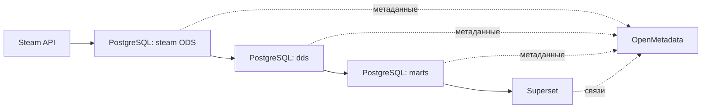

# Лабораторная работа №3

## Цель и границы

Построить аналитические витрины на DDS Steam, подготовить визуализации в Superset и описание происхождения данных в OpenMetadata. `ArchPlan3.md` и текст задания в рабочем дереве не обнаружены, поэтому соответствие им пока не подтверждено; фактический контракт зафиксирован в `docs/lab3_contract.md`, допущения — в `docs/lab3_assumptions.md`.

## Архитектура



Основные источники — `steam.ods_games`, `steam.ods_reviews` и `steam.ods_player_stats`. DDS хранит игры и отзывы как SCD2 и факты с ключами конкретных версий. В отличие от старых проектных заметок, актуальный ODS для этих данных находится в PostgreSQL, не в MongoDB или ClickHouse. Инициализация SQL при первом создании тома не обновляет уже существующую базу.

## Методика аналитики

Дневной grain игры — дата и `game_sk`; часовой — дата, час и `game_sk`, время UTC. Отзывы и активность агрегируются независимо до соединения, чтобы избежать умножения строк фактов. В подсчёте участвует текущая версия отзыва; прошлые значения голосов таким методом не восстанавливаются. При загрузке DDS отсутствующий признак `voted_up` заменяется на `false`, что влияет на долю положительных. Для рейтинга игр версии объединяются по `appid`, средний онлайн взвешивается по числу снимков `samples`. Округление исходных часовых средних может вносить погрешность.

Игра может иметь несколько жанров и издателей. Приписывание каждой категории полного значения не означает, что суммы по категориям равны общему итогу: это неаддитивные срезы. Снимки Steam и отзывы относятся к доступной выборке, а не ко всем играм и всем моментам времени. `dds_facts_dag` по умолчанию выбирает первые 50 000 отзывов по дате создания без пагинации и собирает активность за закрытое окно. Сбор онлайна ограничен числом игр и не задаёт порядок выборки. Промежуточные файлы онлайна имеют только дневную директорию: повторные прогоны её перезаписывают, а параллелизм DAG ограничен одним запуском. Эти ограничения необходимо учитывать при интерпретации.

## Визуализации и гипотезы

| Визуализация | Аналитическая задача | Гипотеза, не результат |
|---|---|---|
| Топ-15 игр по среднему онлайну, горизонтальные столбцы | Сопоставить игры на единой шкале | Небольшая группа игр может иметь заметно больший средний онлайн. |
| День недели и час UTC, тепловая карта | Выявить временную структуру | В некоторые часы и выходные активность может быть выше. |
| Динамика отзывов и доли положительных, линии | Сопоставить объём и оценку во времени | Волны отзывов могут сопровождаться изменениями доли положительных. |
| Топ-10 жанров по отзывам, столбцы | Сравнить охват обсуждений | Часть жанров может собирать больше отзывов. |
| Доля положительных по жанрам, столбцы | Сравнить относительные оценки | Жанры могут различаться по доле положительных отзывов. |
| Издатели: отзывы и средний онлайн, диаграмма рассеяния | Сравнить две различные метрики | Между обсуждаемостью и онлайном может быть зависимость, которую нужно проверить. |

Результаты после фактического запуска: период `[УКАЗАТЬ]`, число игр `[УКАЗАТЬ]`, количество отзывов `[УКАЗАТЬ]`, наблюдаемые закономерности `[УКАЗАТЬ]`. Никакие фактические значения или подтверждения гипотез до запуска не заявляются.

### Проверочные запросы

```sql
-- Топ объединяет SCD2-версии одной игры по appid.
SELECT appid, SUM(avg_players * samples) / NULLIF(SUM(samples), 0) AS avg_players,
       SUM(samples) AS samples
FROM marts.mart_game_daily_metrics
WHERE samples > 0
GROUP BY appid
ORDER BY avg_players DESC NULLS LAST
LIMIT 15;

-- Объём и доля актуальных отзывов по дате события.
SELECT activity_date, SUM(review_count) AS reviews,
       SUM(positive_reviews)::numeric / NULLIF(SUM(review_count), 0) AS positive_ratio
FROM marts.mart_game_daily_metrics
GROUP BY activity_date ORDER BY activity_date;

-- Проверка охвата исходных фактов и версий.
SELECT COUNT(*) AS review_versions,
       COUNT(*) FILTER (WHERE r.is_current) AS current_reviews
FROM dds.fact_review f JOIN dds.dim_review r USING (review_sk);
```

## Проверка и защита

Витрины и проверки качества следует выполнить после успешной загрузки DDS за совпадающий logical date; результаты и покрытие должны быть проверены по журналам Airflow и SQL. Без запущенных сервисов корректность взаимодействия Airflow, PostgreSQL, Superset и OpenMetadata, а также визуальное оформление и производительность не проверены.

В `dds_facts_dag` сенсор ждёт все восемь трёхчасовых запусков онлайна за закрытый дневной интервал. При первом включении с `catchup=False` некоторых запусков может не существовать; требуется планировать заполнение будущего полного интервала и отдельно проверять статусы. Ручной запуск задним числом не восстанавливает исторический онлайн: Steam API возвращает текущий снимок.

### Утренний запуск

1. Выделить Docker не менее 8 ГБ памяти. В игнорируемом `.env` задать переменные из `.env_example` и `.env_lab3_example`, заменить все заглушки и указать действительный `FERNET_KEY`. Секреты не включать в отчёт или скриншоты.
2. Запустить `bash scripts/lab3_bootstrap.sh` из корня репозитория в Git Bash. Скрипт поднимает стек и применяет DDL витрин; при существующих несовместимых таблицах `CREATE TABLE IF NOT EXISTS` не заменяет миграцию. Для уже запущенного стека используется `--no-up`.
3. Проверить состояние контейнеров `docker compose -f docker-compose.yaml -f docker-compose.lr3.yml --profile lr3 ps`, журналы и UI Airflow. Дождаться успешных ODS и DDS, включая соответствующие трёхчасовые интервалы; запустить `build_marts_dag` с тем же `logical_date`, что у успешного `dds_facts_dag`. Проверить `marts.mart_dq_results` и заполненность витрин.
4. Следовать `lab3/bi/README.md` для подключения читателя, создания SQL-представлений и импорта дашборда. Проверить все шесть графиков и фактические периоды. При ошибке API использовать описанный в инструкции ручной вариант, не считать импорт успешным только по наличию графиков.
5. Следовать `lab3/metadata/README.md` для ingestion и lineage. Проверить фактические таблицы и связи в OpenMetadata; автоматический коннектор Airflow 3 не подтверждён, ручная регистрация может потребоваться.

Весь overlay предназначен только для локальной разработки: OpenSearch без аутентификации доступен контейнерам общей сети. Смена переменных пароля не меняет существующие роли БД или учётную запись Superset автоматически. Полный пересчёт витрин блокирует их читателей на время транзакции; DQ требует строки за закрытые сутки и факты для текущих отзывов, поэтому при неполном DDS публикация откатывается.

**Ограничение проверки:** исправления замечаний ревью BI, включая layout API и повторное использование объектов, требуют проверки на реальном Superset. Роль `om_reader` имеет доступ к текстам отзывов и идентификаторам пользователей; не применять её без оценки прав. Для OpenMetadata ingestion и API lineage также нет интеграционного подтверждения.

Для защиты снять скриншоты: успешные запуски ODS/DDS и DAG витрин; результат DQ; схему таблиц витрин и строки с датами; общий дашборд со всеми визуализациями; подключение Superset и датасеты; каталог таблиц и lineage в OpenMetadata; вывод проверочных запросов и фактический период данных. Не включать секреты в кадр.
