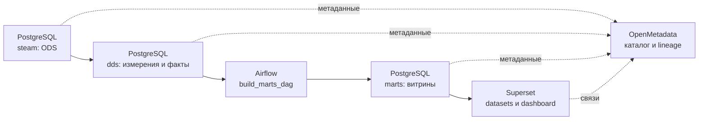

# Лабораторная работа №3

## «Витрины данных. Визуализация и Data Lineage»

- **Проект:** аналитика данных Steam на основе DDS-слоя.
- **Оркестрация:** Apache Airflow 3.3.2.
- **Хранилище:** PostgreSQL 16.
- **Визуализация:** Apache Superset 4.1.2.
- **Каталог метаданных:** OpenMetadata 1.8.0.

---

## 1. Цель работы

Построить аналитический слой на основе данных ЛР2:

1. создать витрины для анализа отзывов и активности игроков;
2. организовать обновление витрин и проверку их качества в Apache Airflow;
3. подготовить набор визуализаций и дашборд в Apache Superset;
4. описать происхождение данных от ODS до витрин и дашборда в OpenMetadata;
5. подготовить проверочные запросы и инструкции для воспроизведения.

## 2. Исходные данные DDS

Источником витрин служит DDS-слой PostgreSQL, построенный в ЛР2.

| Таблица | Назначение |
|---|---|
| `dds.dim_game` | версии игр и их атрибуты, включая `appid` и название |
| `dds.dim_review` | версии отзывов, оценка и время создания |
| `dds.fact_review` | связь версии отзыва с игрой и пользователем |
| `dds.fact_player_activity` | почасовые показатели онлайна игр |
| `dds.dim_genre`, `dds.bridge_game_genre` | жанры и их связь с версиями игр |
| `dds.dim_publisher`, `dds.bridge_game_publisher` | издатели и их связь с версиями игр |

Измерения игр и отзывов используют SCD2. Факты ссылаются на конкретные версии через `game_sk` и `review_sk`; для объединения версий одной игры используется `appid`.

## 3. Архитектура решения

### 3.1. Компоненты

- **PostgreSQL** хранит исходные данные ODS в схеме `steam`, DDS в схеме `dds` и витрины в схеме `marts`.
- **Apache Airflow** ожидает завершения загрузки DDS и управляет пересчётом витрин и проверками качества.
- **Apache Superset** предназначен для подключения к BI-представлениям и построения дашборда.
- **OpenMetadata** предназначен для каталога метаданных и отображения связей между источниками, витринами и дашбордом. Для поиска используется OpenSearch.
- **Отдельные базы PostgreSQL** используются для метаданных Superset и OpenMetadata.

### 3.2. Поток данных



Рисунок показывает целевую цепочку происхождения данных. Фактическое отображение связей в OpenMetadata проверяется после загрузки метаданных.

## 4. Витрины данных

Витрины создаются в схеме `marts`. Первичные и внешние ключи связывают их с измерениями DDS; дополнительно созданы индексы по `appid` и дате для витрин игр и активности.

### 4.1. `marts.mart_game_daily_metrics`

**Зерно:** `(activity_date, game_sk)`.

| Поля | Назначение |
|---|---|
| `activity_date`, `game_sk`, `appid`, `game_name`, `is_free` | дата и версия игры |
| `review_count`, `positive_reviews`, `negative_reviews` | количество отзывов по оценке |
| `positive_ratio`, `avg_weighted_score` | доля положительных отзывов и среднее значение `weighted_score` |
| `avg_players`, `max_players`, `current_players`, `samples` | показатели онлайна и число снимков |
| `hours_covered`, `loaded_at` | число часов с активностью и время загрузки |

Отзывы и активность агрегируются независимо до `(activity_date, game_sk)` и соединяются через `FULL OUTER JOIN`. Это предотвращает перемножение строк при соединении двух фактов и сохраняет даты, для которых есть только отзывы или только активность.

### 4.2. `marts.mart_activity_hourly`

**Зерно:** `(activity_date, hour_of_day, game_sk)`.

Витрина содержит `appid`, название игры, текущий, средний и максимальный онлайн, а также число снимков `samples`. Дата и час в исходном факте вычисляются в UTC. День недели рассчитывается при построении BI-представления.

### 4.3. `marts.mart_genre_daily_metrics`

**Зерно:** `(activity_date, genre_id)`.

Содержит название жанра, число игр `games_count`, количество и долю положительных отзывов, средний и максимальный онлайн и число снимков. Данные дневной витрины игр связываются с жанрами через `dds.bridge_game_genre`. Число игр считается по различным `appid`, чтобы разные версии одной игры не увеличивали показатель.

### 4.4. `marts.mart_publisher_daily_metrics`

**Зерно:** `(activity_date, publisher_id)`.

Дополнительная витрина строится аналогично жанровой, но через `dds.bridge_game_publisher`. Она позволяет сопоставлять количество отзывов и средний онлайн игр издателя.

Игра может относиться к нескольким жанрам или издателям, поэтому её показатели участвуют в каждой соответствующей категории. Сумма метрик по категориям не обязательно совпадает с общим итогом по играм.

## 5. Расчёт показателей

### 5.1. Отзывы

- Для подсчёта выбирается текущая версия отзыва из `dds.dim_review`; версия связывается с фактом по `review_sk`.
- Датой события считается дата `timestamp_created` в UTC.
- `positive_ratio` рассчитывается как `positive_reviews / review_count`; если отзывов нет, значение равно `NULL`.
- В DDS отсутствующий признак `voted_up` приводится к `false` и учитывается как отрицательная оценка.

История агрегируется по дате создания отзыва, но с его текущей оценкой. Поэтому изменение оценки может изменить показатель за прошлый день; предыдущая тональность на момент события таким способом не восстанавливается.

### 5.2. Онлайн

Средний онлайн за несколько часов или игр рассчитывается с учётом числа исходных снимков:

```text
avg_players = sum(avg_players_часа * samples_часа) / sum(samples_часа)
```

Для рейтинга игр SCD2-версии объединяются по `appid`. Средний онлайн жанра или издателя представляет среднее по снимкам отдельных игр, а не суммарный онлайн категории. Максимум категории — максимальное значение отдельной игры. Часовые значения DDS округлены, поэтому итоговое среднее может содержать небольшую погрешность.

## 6. DAG обновления витрин

### 6.1. `build_marts_dag`

- **Расписание:** `@daily`.
- **Слой:** витрины `marts`.
- **Ограничение параллелизма:** `max_active_runs = 1`.

Задачи:

```text
wait_for_dds_facts
  -> check_prerequisites
  -> rebuild_marts
  -> log_mart_run
```

1. `wait_for_dds_facts` ожидает успешного `dds_facts_dag` с тем же `logical_date`.
2. `check_prerequisites` проверяет наличие исходных таблиц и текущих версий игр.
3. `rebuild_marts` полностью пересчитывает четыре витрины и выполняет проверки качества.
4. `log_mart_run` сохраняет сводку о запуске.

Очистка и заполнение витрин выполняются в одной транзакции с уровнем изоляции `REPEATABLE READ`. Проверки запускаются до фиксации транзакции; при ошибке изменения откатываются. Блокировки предотвращают одновременную публикацию, но на время пересчёта могут задерживать чтение витрин.

## 7. Data Quality

### 7.1. Проверки

| Проверка | Что проверяет |
|---|---|
| `uniqueness` | отсутствие дублей по зерну четырёх витрин |
| `ratio`, `review_arithmetic` | диапазон доли положительных отзывов и согласованность числителей и общего количества |
| `review_count_source` | равенство числа отзывов в витрине игр и доступных текущих фактов DDS |
| `current_reviews_without_fact` | отсутствие текущих версий отзывов без соответствующего факта |
| `avg_le_max` | неотрицательность онлайна и условие `avg_players <= max_players` |
| `activity_completeness` | соответствие числа точек и суммы `samples` исходному факту активности |
| `orphans` | отсутствие ключей игры, жанра и издателя без измерений |
| `freshness_*` | наличие строк в каждой витрине за последние закрытые UTC-сутки интервала запуска |

Результаты сохраняются в `marts.mart_dq_results`; сводка запуска также записывается в `data/processed/marts/<ds>/results.json`. Успешные проверки фиксируются вместе с витринами, а результаты неудачного пересчёта записываются отдельно после отката.

### 7.2. Результаты проверок

Результаты DQ на данных проекта необходимо получить после запуска `build_marts_dag`:

| Показатель | Результат |
|---|---|
| Дата и идентификатор запуска | `[УКАЗАТЬ]` |
| Количество проверок со статусом `passed` | `[УКАЗАТЬ]` |
| Количество проверок со статусом `error` | `[УКАЗАТЬ]` |

Прохождение проверок на данных проекта до выполнения DAG не подтверждено.

## 8. Визуализация в Superset

### 8.1. Подключение и datasets

Для Superset подготовлена роль `superset_reader` с правом чтения шести BI-представлений схемы `marts`. Представления формируют данные для отдельных графиков, а скрипт настройки предназначен для создания подключения, datasets и дашборда через API Superset.

### 8.2. Визуализации

| Визуализация | Тип | Аналитическая задача |
|---|---|---|
| Топ-15 игр по среднему онлайну | столбчатая диаграмма | сравнить игры по популярности; версии объединяются по `appid` |
| Активность по дню недели и часу UTC | тепловая карта | определить периоды повышенной активности |
| Динамика отзывов и доли положительных | столбцы и линия | сопоставить число отзывов и изменение доли положительных оценок |
| Топ-10 жанров по отзывам | столбчатая диаграмма | сравнить объём обсуждения жанров |
| Положительные и отрицательные отзывы по жанрам | составная столбчатая диаграмма | сравнить состав оценок по жанрам |
| Издатели: отзывы и средний онлайн | пузырьковая диаграмма | сопоставить объём отзывов и онлайн; размер пузыря отражает `samples` |

Столбчатые диаграммы удобны для сравнения категорий, линия — для временной динамики, тепловая карта — для распределения по дням и часам, а пузырьковая диаграмма — для сопоставления нескольких показателей.

### 8.3. Аналитические наблюдения

После загрузки витрин необходимо определить период данных и проверить, какие игры и жанры лидируют по выбранным метрикам, в какие часы наблюдается повышенный онлайн и как меняется доля положительных отзывов.

| Показатель | Значение |
|---|---|
| Анализируемый период | `[УКАЗАТЬ]` |
| Игра с наибольшим средним онлайном | `[УКАЗАТЬ]` |
| Жанр с наибольшим числом отзывов | `[УКАЗАТЬ]` |
| Наблюдаемые пики активности | `[УКАЗАТЬ]` |

Выводы по этим показателям формулируются после выполнения запросов и проверки дашборда.

## 9. Data Lineage

Для OpenMetadata подготовлены рецепт загрузки метаданных PostgreSQL и декларация связей. Предусмотрена цепочка:

```text
steam.ods_games / ods_reviews / ods_player_stats
  -> dds: измерения, мосты и факты
  -> marts: витрины
  -> BI-представления и дашборд Superset
```

Связи таблиц и pipeline-сущностей предусмотрены через API OpenMetadata. Создание сущности дашборда и его связей выполняется отдельным флагом. Автоматический коннектор Airflow оставлен отключённым: его совместимость с Airflow 3.3.2 не проверена. Отображение lineage и поддержка прямых связей с дашбордом требуют проверки в UI после запуска.

## 10. Воспроизводимость

Перед запуском необходимо выделить Docker не менее 8 ГБ памяти, настроить `.env` по `.env_example` и `.env_lab3_example`, а также заполнить переменные для BI и метаданных. Пароли и токены не должны попадать в отчёт и скриншоты.

Поднять стек и создать схему витрин:

```bash
bash scripts/lab3_bootstrap.sh
```

Для уже запущенного стека используется `bash scripts/lab3_bootstrap.sh --no-up`. Скрипт создаёт таблицы витрин, но не заменяет миграцию существующих таблиц с другой структурой.

После успешной загрузки ODS и DDS запустить `build_marts_dag` за тот же `logical_date`, что и `dds_facts_dag`, затем подготовить BI-представления и объекты Superset:

```bash
bash lab3/bi/bootstrap.sh
```

Для загрузки метаданных и добавления связей с дашбордом:

```bash
bash lab3/metadata/bootstrap.sh --with-dashboard
```

Перед запуском BI и metadata-скриптов должны быть настроены соответствующие подключения и учётные данные. Роль `om_reader` имеет доступ на чтение к исходным отзывам и идентификаторам авторов; её права необходимо оценить до применения.

### 10.1. Проверочные запросы

```sql
-- Объём и период данных витрин.
SELECT count(*) AS row_count, min(activity_date) AS first_date,
       max(activity_date) AS last_date
FROM marts.mart_game_daily_metrics;

-- Результаты проверок качества.
SELECT check_name, status, metric_value, threshold, checked_at
FROM marts.mart_dq_results
ORDER BY checked_at DESC;

-- Топ игр: объединение версий SCD2 по appid.
SELECT appid, sum(avg_players * samples) / nullif(sum(samples), 0) AS avg_players,
       sum(samples) AS samples
FROM marts.mart_game_daily_metrics
WHERE samples > 0
GROUP BY appid
ORDER BY avg_players DESC NULLS LAST
LIMIT 15;
```

## 11. Ограничения

- Запуск полного стека, DAG, дашборда и ingestion не выполнен; работоспособность API Superset и OpenMetadata, визуализаций и lineage необходимо подтвердить в работающей среде.
- `dds_facts_dag` ожидает восемь трёхчасовых запусков онлайна за закрытые сутки. При `catchup=False` часть запусков может отсутствовать; повторный запрос Steam не восстанавливает исторический онлайн.
- По умолчанию DDS загружает ограниченное число отзывов по дате создания, а сбор онлайна ограничен числом выбранных игр. Результаты относятся к собранной выборке, а не ко всему каталогу Steam.
- При отсутствии текущих фактов отзывов или строк за закрытые сутки DQ останавливает публикацию витрин.
- OpenSearch в конфигурации локальной разработки работает без аутентификации внутри сети Compose. Изменение паролей в окружении не обновляет автоматически учётные данные в существующих томах.
- Исторические оценки отзывов и общий онлайн категории не восстанавливаются выбранным способом агрегации.

## 12. Заключение

В рамках ЛР3 подготовлены:

- четыре витрины PostgreSQL для игр, активности, жанров и издателей;
- DAG полного пересчёта витрин с проверками качества и журналом результатов;
- BI-представления и настройки шести визуализаций Superset;
- рецепт загрузки метаданных и декларация lineage для OpenMetadata;
- скрипты запуска и проверочные SQL-запросы.

Для завершения работы необходимо выполнить полный прогон, проверить показатели и связи в интерфейсах и зафиксировать результаты. Для защиты подготовить скриншоты DAG и DQ, витрин и SQL-запросов, дашборда Superset и lineage в OpenMetadata.
